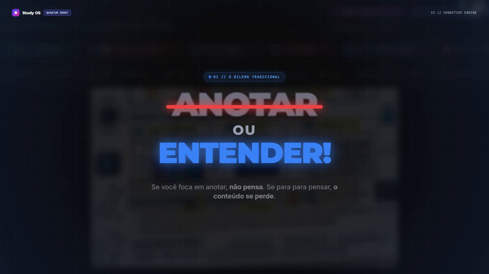

# ⚡ Study OS — Dashboard Quantum Smart


O **Study OS** é uma plataforma SPA (*Single Page Application*) de alta performance desenvolvida para organizar e acelerar a rotina acadêmica universitária sob a filosofia *Quantum Smart*. O sistema integra controle de semestres e disciplinas, cálculo de notas e presença em tempo real, visualização contínua de aulas em Markdown (Acordeão H1 com 15 blocos pedagógicos), reprodutor multimídia imersivo com lupa óptica interativa 2.2x, alternância de tema (**Modo Escuro Padrão & Modo Claro**) e sincronização híbrida com **Notion**, **Google Drive** e **Firebase Realtime Database** — tudo sem necessidade de build ou bundler.



🎬 **Teaser Oficial & Manifesto:** Assista à demonstração completa e conheça a engenharia cognitiva do sistema na página [Sobre o Projeto (sobre.html)](sobre.html#teaser-video) ou pelo vídeo `assets/study-os-teaser_2026-10-18_14-42-23.mp4`.

---

## 🧩 As 7 Camadas Multimídia da Aula (Arquitetura Cognitiva & Técnica)

Cada aula no **Study OS** processa o conhecimento através de um pipeline progressivo e multimodal sob demanda (combinável na barra de filtros ou no **Modo Cinema / Playlist**). O conteúdo muda a cada tema, mas a arquitetura cognitiva, estética e técnica de cada camada permanece invariante:

1. **📝 1. Resumo Estruturado em Markdown (`.MD` — Camada Base):**
   * **Engenharia Pedagógica:** Apostila interativa padronizada na metodologia de **15 Blocos (*Notion Content Tutor*)** — cobrindo Resumo, Tópicos, Análise em 4 dimensões (Definição, Conceito, Analogia e Aplicação), Estudo de Caso Real, Perguntas de Revisão, *Pitfalls*, Checklist, *Clean Code* (Errado vs. Certo), Mini Desafio Prático com solução retrátil, Glossário, Conexão com o Futuro, Bibliografia e Mapeamento de Arquivos.
   * **Motor Técnico:** Parser otimizado por cache LRU (200 entradas), desescape automático de Markdown exportado, blocos retráteis `<details>` para resolução de problemas, checkboxes persistentes e editor inline com sincronização em nuvem.

2. **📱 2A. Infográfico Vertical Sketchnote (`.JPG` — Revisão Rápida):**
   * **Identidade Visual (*Estilo Caderno Aluno 10*):** Síntese visual estruturada como uma página de caderno inteligente gamificada, equipada com cabeçalho HUD (*Health/XP Bar*), ícones técnicos nas margens, diagrama de arquitetura central e tabela comparativa de tomada de decisão (✔️ vs. ❌).
   * **Motor Técnico:** Visualização responsiva calibrada para leitura mobile e desktop nos modos **10:16 Ideal**, **9:16**, **Sem Crop** e inspeção com zoom interativo.

3. **🖼️ 2B. Blueprints & Mapas Isométricos (`.PNG` / `.JPG` — Arquitetura Profunda):**
   * **Identidade Visual (*"IBM meets Cyberpunk 2077"*):** Arte digital 3D e vetorial em **Strict Dark Mode** (fundos *obsidian/charcoal* com grade hexagonal), utilizando *overlays* de Esports/HUD, barras de progresso, iluminação volumétrica e paleta neon de alto contraste (Ciano para dados, Roxo para profundidade e Laranja para alertas) para mapear fluxos de sistemas complexos.
   * **Motor Técnico:** Renderização em alta definição projetada para inspeção cirúrgica com **Lupa Interativa 2.2x** e *fallback* automático entre Google Drive e disco local.

4. **🖥️ 3. Deck de Slides Cinematográfico (`.PDF Sem OCR` — Camada 3):**
   * **Identidade Visual (*Unreal Engine & Gamer Edition*):** Apresentação executiva em estética **Cyber-Industrial** e *Strict Dark Mode*. Converte conceitos abstratos em **Mecânicas de Jogo** (*Health Bars*, *Buffs*, *Loadout Matrices*, *Logs de Dano* e *Wombo Combos*) dentro de uma narrativa de Jornada do Herói (*Ameaça ➔ Arma ➔ Mapa ➔ Centro de Comando ➔ Escudo ➔ Vitória*), contrastando renders 3D realistas com ícones retrô em *8-bit Pixel Art*.
   * **Motor Técnico:** Filtro inteligente na interface que renderiza no corpo da aula exclusivamente **PDFs visuais (sem camada OCR)**, isolando documentos densos de texto para não poluir a experiência visual.

5. **🎬 4. Vídeo Conceitual & Motion Storyboard (`.MP4` / `.MOV` / `.WEBM` — Camada 4):**
   * **Direção & Estética (*Cinematic Tech & DevOps Edition*):** Produzido sob a persona *Digital Architect & Director* (tom de *Tech Lead* moderno e direto). Elimina o formato monótono de *talking head* em favor de uma narrativa visual em 5 cenas (*Hook, Foundation, Connection, Application e Synthesis*), combinando fundo *Deep Navy*, telas divididas com código, fluxogramas animados e visões 3D isométricas.
   * **Motor Técnico:** Streaming direto via API do Google Drive ou reprodução local em HTML5, integrado ao player da aula e à **Playlist Contínua**.

6. **🎧 5. Áudio / Podcast Deep-Dive (`.M4A` / `.MP3` / `.WAV` — Camada 5):**
   * **Arquitetura Cognitiva (*Cognitive Mastery Edition*):** *Audio-essay* de alta resolução guiado pela persona *Distinguished Technical Architect* (inspirada em *Lex Fridman* e *Robert C. Martin*). Opera sob a regra **Zero Fluff** e protocolo **First Principles** — explicando sempre a dor arquitetural (*Why*) antes da tecnologia (*How*), usando analogias estruturais precisas tanto no modo **Granular** (foco na aula) quanto **Holístico** (síntese da matéria).
   * **Motor Técnico:** Player de áudio nativo com controle de velocidade, *fallback* automático para o *Google Drive Preview Player* e opção de download direto para escuta offline.

7. **🤖 6. Caderno Interativo (NotebookLM) & 📂 7. Material Bruto (Bloco 15):**
   * **6. Segundo Cérebro Assistido por IA:** Conexão direta com o caderno da aula no **Google NotebookLM** e diretório no **Google Drive**, protegido por **Auditoria de Duplicidade em Tempo Real** (que alerta automaticamente caso o mesmo ID de caderno seja vinculado a aulas distintas).
   * **7. Cofre de Referências e Código (`Bloco 15` — Exclusivo Modo Admin):** Modal dedicado (`ArquivosReferenciasModal.js`) alimentado pelo mapeamento final do resumo Markdown e equipado com busca *Fuzzy Matching* (tolerante a erros de digitação). Filtra e exibe exclusivamente **PDFs teóricos com OCR**, scripts e códigos-fonte (`.py`, `.sql`, `.java`, `.c`, `.ipynb`) e *datasets* brutos (`.csv`, `.json`, `.parquet`). Por governança de **direitos autorais**, este cofre fica **100% oculto para visitantes** e acessível apenas ao Administrador autenticado.

---

## 📋 Pré-requisitos

* Um navegador web moderno (**Google Chrome**, **Firefox**, **Edge** ou **Safari**) com suporte a ES6 Modules.
* Para rodar localmente: extensão **Live Server** (VS Code) ou servidor HTTP simples (`npx serve .` ou `python -m http.server 8000`).
* [Node.js](https://nodejs.org/) v18+ (opcional, para rodar os 48 testes unitários nativos com `npm test`).
* [Python 3.10+](https://www.python.org/) (opcional, necessário apenas para os scripts de ingestão `gerar_db.py`, `sincronizador_notion.py` e `Sincronizador da Fila (Rode no PC).py`).

---

## 🚀 Instalação e Execução Local

1. **Clone o repositório:**
   ```bash
   git clone https://github.com/renanratinh0/study-os.git
   cd study-os
   ```

2. **Execute em um servidor HTTP local:**
   Abra com o **Live Server** no VS Code ou execute:
   ```bash
   npx serve .
   ```
   > Por padrão em produção, o `inicializarApp()` em `src/main.js` carrega primeiro o banco sincronizado no Firebase (`/db_json`) e utiliza o `db.json` demonstrativo local automaticamente como fallback offline.

3. **Execute a suíte de testes automatizados (48 testes):**
   ```bash
   npm test
   ```

---

## 🔒 Segurança & Direitos Autorais: Modo Visitante vs. Modo Administrador

A arquitetura permite publicar o caderno no **GitHub Pages** em modo público sem risco de visitantes alterarem dados, corromperem a fila de sincronização ou acessarem materiais brutos de terceiros protegidos por direitos autorais:

* **Modo Visitante (Padrão):** Leitura livre de semestres, matérias, notas, resumos autorais em Markdown, Lupa 2.2x 360° e Modo Cinema. Avisos internos de *"Falta mídia"*, botões de edição e o **Cofre de Material Bruto (`📂 7. Material Bruto / Bloco 15`)** ficam **100% ocultos e bloqueados** para proteger direitos autorais de professores, livros e apostilas originais.
* **Modo Administrador (Com Senha):** Ações de escrita (editar notas, alterar presença/datas/links, editar metadados da matéria e salvar edições de Markdown) e a consulta ao **Material Bruto (PDFs com OCR e documentos originais)** exigem desbloqueio no botão **🔒 Visitante / 🔓 Admin** da barra superior.
  * O modal de autenticação utiliza hash **SHA-256 via Web Crypto API** e conta com atributos padrão `autocomplete="current-password"` para integração nativa com o gerenciador de senhas do navegador.

> **🛡️ Proteções garantidas pelas regras (`database.rules.json`):**
> * **`/db_json`**: Leitura pública para que visitantes vejam o caderno no GitHub Pages, com **escrita 100% bloqueada** sem autenticação (`auth != null`).
> * **`/fila_md`**: Leitura restrita a `auth != null` (apenas o sincronizador Python lê a fila). A escrita pública é permitida apenas para **criação de novos itens individuais** (`!data.exists() && newData.exists()`) validados por schema — impedindo que terceiros leiam, sobrescrevam ou apaguem a fila (`DELETE /fila_md` bloqueado).
> * **`/notion` e `$other`**: Bloqueados para qualquer acesso não autenticado.

---

## ☁️ Automações Python (Opcional — Uso Local)

### 1. Sincronizador de Fila e Notion
Renomeie `notion_config.example.json` para `notion_config.json` (protegido pelo `.gitignore`) e informe suas chaves privadas:
```json
{
  "token": "SEU_NOTION_INTEGRATION_TOKEN",
  "database_id": "SEU_NOTION_DATABASE_ID",
  "cache_file": "notion_cache.json",
  "firebase_secret": "SEU_FIREBASE_DATABASE_SECRET_OU_AUTH_TOKEN"
}
```
Execute o processador local:
```bash
python "Sincronizador da Fila (Rode no PC).py"
```

### 2. Gerador de Banco de Dados (`gerar_db.py`)
Para indexar suas pastas locais do Google Drive e gerar seu banco privado (`db.personal.json`):
1. Copie `credentials.example.json` para `credentials.json` com seu OAuth do [Google Cloud Console](https://console.cloud.google.com/).
2. Execute:
   ```bash
   python gerar_db.py
   ```

---

## 📂 Estrutura do Projeto

```text
├── assets/
│   ├── Banner 1920×640@1x.png                    # Banner widescreen oficial (1920×640)
│   ├── logo-simbolo.svg                          # Símbolo vetorial puro
│   ├── logo-transparente.svg                     # App Icon (squircle) oficial
│   ├── preview.png                               # Captura de tela principal
│   ├── study-os-horizontal-fundo-claro.svg       # Logotipo horizontal (fundo claro)
│   ├── study-os-horizontal-fundo-escuro.svg      # Logotipo horizontal (fundo escuro)
│   ├── study-os-teaser_2026-10-18_14-42-23.mp4   # Vídeo teaser oficial 1080p
│   ├── study-os-vertical-fundo-claro.svg         # Logotipo vertical (fundo claro)
│   └── study-os-vertical-fundo-escuro.svg        # Logotipo vertical (fundo escuro)
├── src/
│   ├── core/
│   │   ├── constants.js                   # Constantes, temas, presets de mídia e URL do Firebase
│   │   ├── router.js                      # Roteador Hash SPA (#/ e #/disciplina/:id)
│   │   └── store.js                       # Store reativo (Observer), normalização e auditoria NotebookLM
│   ├── services/
│   │   ├── api.js                         # Leitura Firebase/local e despacho de fila
│   │   ├── auth.js                        # Autenticação SHA-256 (Modo Visitante vs Admin)
│   │   ├── mediaResolver.js               # Resolução Drive/Local/Blobs com revogação de memória
│   │   └── storage.js                     # Persistência segura no localStorage e controle de Tema
│   ├── components/
│   │   ├── DisciplineCard.js              # Cards de disciplina (Galeria e pílulas de presença/notas)
│   │   ├── LessonAccordion.js             # Acordeão H1 contínuo e renderização das 7 camadas
│   │   ├── Sidebar.js                     # Árvore lateral hierárquica de semestres e cursos
│   │   └── Topbar.js                      # Breadcrumbs dinâmicos e estatísticas
│   ├── modals/                            # Carregados sob demanda via Dynamic Import
│   │   ├── ArquivosReferenciasModal.js    # Bloco 15 de Rastreabilidade e Material Bruto
│   │   ├── AtividadeModal.js              # Gestão de avaliações, notas e percentuais
│   │   ├── DataAulaModal.js               # Controle de presença, datas e links Drive/NotebookLM
│   │   ├── DisciplineMetaModal.js         # Edição de metadados e capas da disciplina
│   │   ├── ImmersiveCinemaModal.js        # Modo Cinema, Playlists e Lupa Óptica 2.2x 360°
│   │   └── ImportReportModal.js           # Relatório detalhado do banco sincronizado
│   ├── utils/
│   │   ├── domHelpers.js                  # Sanitização XSS, títulos H1 e toasts
│   │   ├── markdownParser.js              # Desescape, parser LRU (200 itens), <details> e Bloco 15
│   │   └── performance.js                 # IntersectionObserver para carregamento lazy de mídias
│   ├── tests/
│   │   ├── auth.test.js                   # Testes de autenticação e governança de UI
│   │   ├── markdownParser.test.js         # Testes do parser, desescape, <details> e Bloco 15
│   │   ├── mediaResolver.test.js          # Testes de URLs do Drive e gestão de Blobs
│   │   ├── modals.test.js                 # Testes de Code Splitting, playlists e visão tabela
│   │   └── store.test.js                  # Testes de store, normalização, temas e NotebookLM
│   └── main.js                            # Orquestrador principal da aplicação
├── database.rules.json                    # Regras de segurança granulares do Firebase RTDB
├── db.json                                # Banco mockup demonstrativo para fallback offline
├── index.html                             # Entrada principal da SPA
├── sobre.html                             # Manifesto do projeto, Prompts XML, Teaser e Contatos
├── gerar_db.py                            # Indexador Google Drive -> JSON
├── sincronizador_notion.py                # Sincronização bidirecional com API do Notion
├── Sincronizador da Fila (Rode no PC).py  # Worker local para processar fila do Firebase
├── auditor_arquivos_md.py                 # Auditor de completude de materiais por aula
├── credentials.example.json               # Template OAuth Google Drive
├── notion_config.example.json             # Template de configuração Notion/Firebase
├── package.json                           # Script de testes nativo (Node test runner)
└── LICENSE                                # Licença Source Available
```

---

## 💻 Tecnologias Utilizadas

* **Frontend:** JavaScript ES6+ Modules nativos, Roteamento Hash sem dependências, Store Reativo (Observer Pattern) e *Dynamic Code Splitting*.
* **Estilização:** [Tailwind CSS](https://tailwindcss.com/) com tema *Quantum Dark* (padrão) e *Light Mode*, tipografia *Inter* e *JetBrains Mono*.
* **Markdown:** [Marked.js](https://marked.js.org/) com cache LRU, desescape automático e higienização contra XSS.
* **Nuvem & Integrações:** [Firebase Realtime Database](https://firebase.google.com/), [Notion API](https://developers.notion.com/) e [Google Drive](https://drive.google.com/).
* **Testes:** Node.js Native Test Runner (`node --test`), com 47 testes unitários automatizados.

---

## 🌐 Contatos & Responsável pelo Projeto

O **Study OS — Dashboard Quantum Smart** foi idealizado, arquitetado e desenvolvido por **Renan Carvalho Cavalcante** (Ciência da Computação). Se você gostou do projeto e deseja conversar sobre oportunidades, propor parcerias, reportar algum erro ou tratar de solicitações formais/administrativas, entre em contato diretamente:

<p align="center">
  <a href="https://github.com/renanratinh0" target="_blank">
    
  </a>
  <a href="https://www.linkedin.com/in/renan-carvalho-cavalcante-74095b237/" target="_blank">
    
  </a>
  <a href="mailto:renancarvalhoce6@gmail.com" target="_blank">
    
  </a>
</p>

---

## 📝 Licença — Source Available

Copyright (c) 2026 **Renan Carvalho Cavalcante**. Este projeto é disponibilizado sob o modelo **Source Available**. Consulte o arquivo [LICENSE](LICENSE) para os termos completos.

* **✅ Uso permitido:**
  * Estudo e aprendizado.
  * Avaliação técnica.
  * Contribuições mediante os termos estabelecidos.
* **🚫 Uso restrito:**
  * Comercialização.
  * Incorporação em produtos empresariais.
  * Redistribuição ou criação de produtos derivados comerciais.

> Para utilização comercial, entre em contato com o autor e solicite uma licença comercial.
